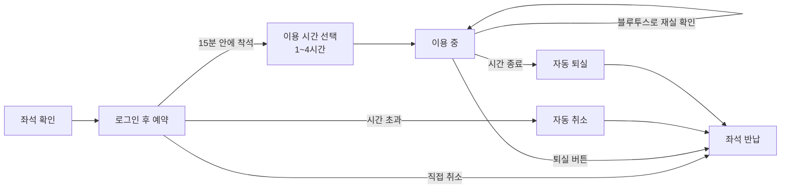
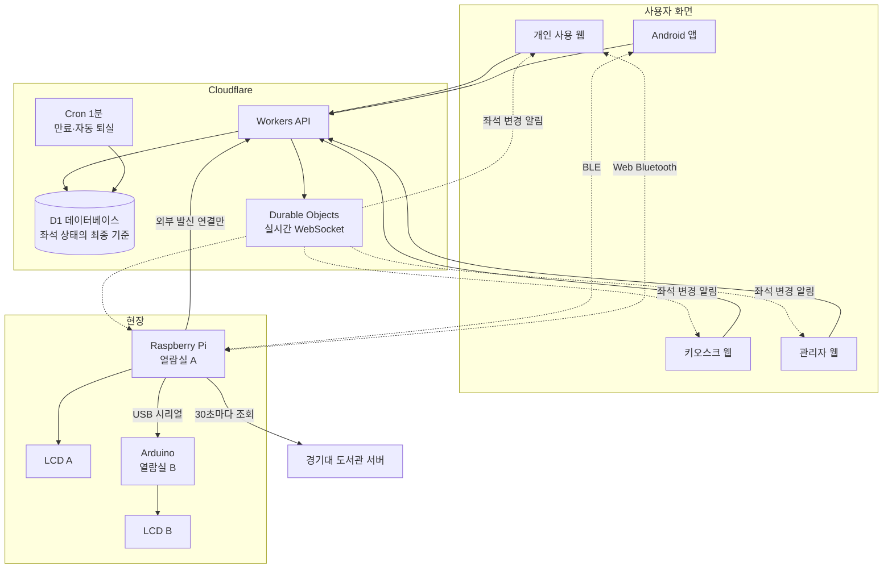

# 📚 예비 도서관 좌석 시스템

> **"시험기간, 자리 찾아 삼만리는 이제 그만."**
> 중앙도서관이 꽉 찼을 때 여는 임시 열람실의 좌석을 휴대폰으로 확인하고, 예약하고, 이용 시간까지 관리하는 시스템입니다.

경기대학교 임시 열람실 **A · B · C** 세 곳, 각 30석, **총 90석**을 웹, 모바일 앱, 라즈베리파이, 아두이노로 함께 운영합니다.

| 📱 개인 사용 | 🏫 키오스크 | 🔧 관리자 | 💓 서버 상태 |
|---|---|---|---|
| [/#/personal](https://library-kiosk.kimkisoo0505.workers.dev/#/personal) | [/#/kiosk](https://library-kiosk.kimkisoo0505.workers.dev/#/kiosk) | [/#/admin](https://library-kiosk.kimkisoo0505.workers.dev/#/admin) | [/api/health](https://library-seat-api.kimkisoo0505.workers.dev/api/health) |

기본 주소([library-kiosk.kimkisoo0505.workers.dev](https://library-kiosk.kimkisoo0505.workers.dev))를 열면 휴대폰은 개인 사용 화면, PC는 키오스크 화면으로 열립니다.

## 목차

1. [왜 만들었나요?](#-왜-만들었나요)
2. [기능 한눈에 보기](#-기능-한눈에-보기)
3. [학생 이용 흐름](#-학생-이용-흐름)
4. [학생 기능](#-학생-기능)
5. [관리자 기능](#-관리자-기능)
6. [현장 장치와 모바일 앱](#-현장-장치와-모바일-앱)
7. [시스템 구조](#-시스템-구조)
8. [안정성과 보안](#-안정성과-보안)
9. [현재 한계와 앞으로의 계획](#-현재-한계와-앞으로의-계획)
10. [개발자 안내](#-개발자-안내)

---

## 🤔 왜 만들었나요?

시험기간의 도서관에는 늘 같은 문제가 있습니다.

- 🏃 중앙도서관은 아침부터 **만석**입니다.
- 🏫 학교가 강의실을 임시 열람실로 열어 주어도, 어디가 비었는지는 **직접 가 봐야** 압니다.
- 🎒 겨우 찾은 빈자리에는 **가방만 놓여 있고** 주인은 몇 시간째 돌아오지 않습니다.

이 프로젝트는 임시 열람실을 **가 보지 않아도 상황을 아는 곳**으로 바꾸고, 쓰지 않는 자리가 다음 사람에게 빨리 돌아가도록 만듭니다.

---

## ✨ 기능 한눈에 보기

상태 표시: ✅ 운영 중 · 🧪 시험 단계 · 🚧 예정 · ⏸️ 보류

| 분류 | 기능 | 상태 |
|---|---|---|
| **좌석** | 열람실 A·B·C 실시간 좌석 현황 | ✅ |
| | 예약 · 취소 · 착석 · 퇴실 | ✅ |
| | 15분 안에 착석하지 않으면 자동 취소 | ✅ |
| | 이용 시간 선택(1~4시간), 종료 시 자동 퇴실 | ✅ |
| | 1인 1좌석(열람실 전체 기준), 동시 예약 방지 | ✅ |
| **블루투스** | 범위 안에서만 착석 가능(열람실 A) | 🧪 |
| | 자리에 있는 동안 이용 시간 자동 연장(열람실 A) | 🧪 |
| **알림** | 주요 동작·마감 임박·자동 처리 팝업 | ✅ |
| | 브라우저 알림(페이지가 열려 있는 동안) | ✅ |
| **기록** | 총 공부 시간, 오늘·최근 7일, 연속 공부 일수 | ✅ |
| | 일별 그래프, 자주 앉는 자리, 이용 기록 | ✅ |
| **주변 정보** | 중앙·금화도서관 잔여석(30초 갱신) | ✅ |
| | 가장 가까운 열람실 찾기(GPS + 카카오맵) | ✅ 휴대폰 브라우저 |
| **관리자** | 좌석 점검 전환, 예약 강제 해제 | ✅ |
| | 좌석 배치 드래그 편집, 강의실 위치 입력 | ✅ |
| | 이용 통계, 이벤트 로그, 장치 상태 | ✅ |
| | 라즈베리파이 원격 종료 | ✅ |
| **현장 장치** | 열람실 A LCD(라즈베리파이) | ✅ |
| | 열람실 B LCD(아두이노) | ✅ |
| | 열람실 C LCD(아두이노) | 🚧 |
| **앱** | Android 앱(웹 화면 + 블루투스 재실 확인) | 🧪 |
| **예정** | 좌석 조건 필터, 빈자리 추천, 입구 카메라·키패드 | 🚧 |
| | 지문 센서 | ⏸️ |

---

## 🎬 학생 이용 흐름



1. **좌석 확인:** 로그인 없이 열람실별 남은 자리와 배치도를 봅니다.
2. **예약:** 학번과 비밀번호로 로그인해 자리를 고릅니다.
3. **착석:** 15분 안에 [착석]을 누르고 이용 시간을 고릅니다. 열람실 입구 LCD에 `Welcome`이 표시됩니다.
4. **이용:** 남은 시간을 확인합니다. 종료 10분 전에는 알림이 옵니다.
5. **퇴실:** [퇴실]을 누르면 자리가 바로 다음 사람에게 돌아갑니다. 시간이 끝나면 자동으로 퇴실됩니다.

---

## 🎓 학생 기능

### 세 가지 화면

화면 맨 위의 **[개인 사용 | 키오스크 | 관리자]** 로 이동합니다. 앱 안에서는 개인 사용 화면만 보입니다.

| | 개인 사용 | 키오스크 |
|---|---|---|
| 용도 | 본인 휴대폰 | 입구의 공용 기기 |
| 자동 로그아웃 | 없음 | 입력이 없으면 90초 뒤 |
| 블루투스 | 사용 | 사용 안 함 |
| 가까운 열람실 찾기 | 사용 | 사용 안 함 |
| 완료 팝업 | 직접 닫음 | 8초 뒤 자동으로 닫힘 |
| 서버 변화·마감 알림 | 사용 | 사용 안 함 |
| 브라우저 알림 | 선택해서 켬 | 보내지 않음 |

### 좌석 현황과 예약

- 좌석은 **이용 가능 · 예약됨 · 사용 중 · 점검 중 · 내 좌석**으로 구분됩니다.
- 관리자가 저장한 **실제 강의실 모양의 배치도**(출입구, 칠판, 창가 포함)로 표시됩니다.
- 누군가 예약하거나 퇴실하면 WebSocket으로 **모든 화면에 바로 반영**됩니다. 연결이 끊기면 30초마다 다시 조회합니다.
- 다른 좌석을 이미 쓰고 있으면 A·B·C 어디에서도 추가로 예약할 수 없습니다.

### 블루투스 착석 확인과 자동 연장

열람실 A에는 라즈베리파이가 블루투스 장치(`LIB-SEAT-PI`)로 동작합니다.

- **착석 확인:** 개인 사용 화면과 앱에서는 장치의 범위 안에 있어야 [착석] 버튼이 활성화됩니다.
- **자동 연장:** 이용 중 범위 안에 있으면 남은 시간이 **2시간 아래로 줄지 않습니다.** 자리를 떠나면 시간이 다시 줄어듭니다.
- **연결 방법:**
  - Android 앱: 신호 세기(RSSI, 기본 −85 dBm 이상)로 판단합니다.
  - Android Chrome·Edge·삼성 인터넷: Web Bluetooth 연결과 응답으로 판단합니다.
  - iPhone Safari·Firefox: Web Bluetooth를 지원하지 않아 입구 키오스크를 이용합니다.
- 블루투스로는 학번, 이름, 토큰을 보내지 않습니다.

### 팝업과 브라우저 알림

| 상황 | 알림 내용 |
|---|---|
| 내 동작 완료 | 예약·착석·퇴실·예약 취소 완료 |
| 착석 마감 5분 전 | 마감 시각과 자동 취소 안내 |
| 이용 종료 10분 전 | 자동 퇴실 시각 안내 |
| 서버 자동 처리 | 미착석 자동 취소, 이용 시간 종료 자동 퇴실 |
| 관리자 조치 | 관리자의 좌석 해제 |
| 다른 기기에서 처리 | 착석, 취소, 퇴실 |

브라우저 알림은 '내 이용' 탭이나 예약 완료 팝업에서 켭니다. 화면을 보고 있으면 팝업만 뜨고, **다른 탭이나 앱을 보고 있을 때** 브라우저 알림이 갑니다.

### 내 이용 기록과 공부 시간

'내 이용' 탭에서 볼 수 있는 항목입니다.

- **총 공부 시간**, 오늘, 최근 7일, 연속 공부 일수
- **최근 7일 막대 그래프**
- 자주 앉는 자리, 평균·최장 이용 시간, 예약 횟수, 미착석 자동 취소 횟수
- **최근 이용 기록:** 좌석, 날짜, 시작·종료 시각, 이용 시간, 종료 사유 ([더 보기] 지원)

공부 시간은 **착석부터 퇴실까지**로 계산하며, 자정을 넘긴 이용은 한국 시간 기준으로 두 날짜에 나눕니다.

### 중앙도서관 · 금화도서관 잔여석

- 경기대 중앙도서관(수원)과 금화도서관(서울)의 열람실별 잔여석, 사용률, 혼잡도, 운영 시간을 보여 줍니다.
- 학교 좌석 페이지와 같은 계산식을 사용합니다.
  `잔여석 = 전체 − (사용 중 + 이용불가 + 고정석 + 비활성 + 지정석)`
- **30초마다** 갱신하며, 이용자 수와 관계없이 학교 서버 조회는 라즈베리파이 한 곳에서만 합니다.

### 가장 가까운 열람실 찾기

- 버튼을 누르면 현재 위치를 확인해 열람실 A·B·C와 중앙도서관 중 **빈자리가 있는 가장 가까운 곳**을 추천합니다.
- 카카오 지도에 내 위치와 장소별 빈자리를 표시하고, 카카오맵 길찾기로 연결합니다.
- 위치는 **휴대폰 안의 거리 계산에만** 쓰고 서버로 보내거나 저장하지 않습니다.

---

## 🔧 관리자 기능

관리자는 학생과 다른 계정 테이블, 다른 로그인, 다른 세션을 사용합니다.

| 메뉴 | 내용 |
|---|---|
| **이용 통계** | 최근 7·14·30일의 총 공부 시간, 착석, 예약, 이용 학생 수, 노쇼 수·비율, 예약 취소 |
| **그래프와 표** | 일별 공부 시간, 시간대별 평균 사용 좌석, 열람실별 집계, 일별 숫자 표 |
| **좌석 관리** | 좌석별 상태 조회, 점검 전환·사용 재개, 사유를 남기는 예약 강제 해제 |
| **좌석 배치 편집** | 좌석과 출입구·칠판·창가를 드래그로 배치. 두 관리자의 동시 저장 충돌 방지 |
| **강의실 위치** | 수원캠퍼스 건물 31곳 목록과 호실 숫자 키패드로 입력 |
| **현장 장치** | 라즈베리파이·아두이노 연결 상태, 네트워크, 원격 종료(2단계 확인) |
| **이벤트 로그** | 예약, 착석, 퇴실, 관리자 조치, 장치 이벤트 기록 |

통계에는 학생별 순위나 학번을 넣지 않습니다.

---

## 🍓 현장 장치와 모바일 앱

| 열람실 | 장치 | LCD | 상태 |
|---|---|---|---|
| **A** | Raspberry Pi 3 B+ | Grove LCD RGB Backlight | ✅ |
| **B** | Arduino UNO R3 (Pi에 USB 연결) | I2C 16x2 LCD | ✅ |
| **C** | Arduino UNO R3 | 예정 | 🚧 |

### 입구 LCD

```
┌────────────────┐        ┌────────────────┐        ┌────────────────┐
│Welcome         │  2초   │Welco           │   …    │                │
│Use 4 Free 26   │  ───▶  │Use 4 Free 26   │  ───▶  │Use 4 Free 26   │
└────────────────┘        └────────────────┘        └────────────────┘
```

- 윗줄은 착석 시 `Welcome`을 표시한 뒤 마지막 글자부터 지웁니다.
- 아랫줄은 그 열람실의 **사용 중 / 빈자리** 수입니다.
- 서버 연결이 끊기거나 정보가 오래되면 틀린 숫자 대신 `Offline`을 표시합니다. 열람실 A의 LCD는 배경도 빨간색으로 바뀝니다.

### 라즈베리파이의 역할

- 서버와 실시간 연결을 유지하고 LCD를 갱신합니다.
- 블루투스 GATT 서버(`library-ble`)를 실행합니다.
- 학교 도서관 잔여석을 30초마다 조회해 서버로 전달합니다.
- 장치 상태를 30초마다 보고하고, 관리자의 원격 종료 명령을 안전 조건 확인 후 처리합니다.
- 등록된 와이파이가 없으면 휴대폰 핫스팟으로 자동 연결합니다.
- 외부로 나가는 연결만 사용하며 포트포워딩이나 인바운드 서버를 열지 않습니다.

### Android 앱

Flutter로 만든 앱입니다. 개인 사용 웹 화면을 WebView로 보여 주고, 블루투스 스캔·연결·신호 측정은 앱이 담당합니다. 로그인 정보는 앱의 블루투스 영역으로 넘기지 않습니다.

---

## 🧩 시스템 구조



| 구성요소 | 위치 | 기술 |
|---|---|---|
| 웹 화면 | [web/kiosk](web/kiosk) | Vite + Vanilla JS, Workers Static Assets |
| API 서버 | [cloudflare/workers](cloudflare/workers) | Cloudflare Workers |
| 데이터베이스 | [cloudflare/database](cloudflare/database) | Cloudflare D1(SQLite), 마이그레이션 0001~0008 |
| 실시간 동기화 | [durable-objects](cloudflare/workers/durable-objects) | Durable Objects + WebSocket Hibernation |
| 현장 에이전트 | [raspberry-pi](raspberry-pi) | Python 3.13, asyncio, httpx, websockets, pyserial |
| 펌웨어 | [arduino](arduino) | Arduino UNO R3, 115200bps ASCII 시리얼 |
| 모바일 앱 | [mobile-app](mobile-app) | Flutter, BLE |
| 지도 | [web/kiosk/src/personal](web/kiosk/src/personal) | Kakao Maps SDK, Geolocation |
| 자동 배포 | [.github/workflows](.github/workflows) | GitHub Actions |

---

## 🛡️ 안정성과 보안

**좌석 정확성**
- 좌석 상태의 최종 기준은 서버의 D1 데이터베이스입니다. 브라우저와 라즈베리파이는 캐시만 가집니다.
- 부분 UNIQUE 인덱스와 조건부 SQL로 **같은 자리를 동시에 눌러도 한 명만** 성공합니다.
- 상태 변경은 이전 상태가 맞을 때만 한 번에 처리합니다.

**장애 시 동작**
- 인터넷이 끊기면 새 예약을 승인하지 않고 LCD에 `Offline`을 표시합니다.
- 아두이노 연결이 끊겨도 좌석 상태는 바뀌지 않습니다.
- 서보모터는 안전 검토 전까지 펌웨어와 에이전트 양쪽에서 잠겨 있습니다.
- D1 Time Travel과 [백업·복구 설명서](docs/BACKUP_RESTORE.md)로 복구할 수 있습니다.

**계정과 개인정보**
- 비밀번호는 PBKDF2-SHA256 해시로, 세션 토큰은 SHA-256 해시로만 저장합니다.
- 학번과 이름만으로는 로그인할 수 없고, 본인 예약만 변경할 수 있습니다.
- 실시간 알림에는 좌석 번호만 담기며 누가 앉았는지는 포함되지 않습니다.
- 위치 정보는 저장하지 않습니다. 재실 확인은 마지막 확인 시각 하나만 덮어쓰고 이동 기록을 남기지 않습니다.
- 현재 계정은 `TEST-0001` 같은 **가짜 테스트 계정**만 사용합니다.

---

## 🚧 현재 한계와 앞으로의 계획

### 알아 둘 한계

| 항목 | 내용 |
|---|---|
| 블루투스 착석 확인 | 화면에서만 막으며 서버는 근접 여부를 검증하지 않습니다. 키오스크 모드나 조작된 클라이언트로 우회할 수 있습니다. |
| 블루투스 적용 범위 | 현재 열람실 A만 지원합니다. |
| 블루투스 검증 | 착석 확인과 Web Bluetooth 흐름은 가짜 장치로 시험했으며 실제 기기 시험이 더 필요합니다. |
| 브라우저 알림 | 페이지가 열려 있는 동안만 동작합니다. 서버 푸시(Web Push)는 아직 없습니다. |
| 로그인 보호 | 로그인 시도 횟수 제한이 아직 없습니다. |
| 시연 설정 | 시연 기간에는 테스트 계정 안내가 화면에 표시됩니다. **실제 운영 전 반드시 끄고 비밀번호를 재설정해야 합니다.** |

### 앞으로의 계획

- [ ] 서버가 검증하는 블루투스 착석 확인(일회용 코드)
- [ ] 로그인 시도 횟수 제한
- [ ] Web Push로 페이지를 닫아도 알림 받기
- [ ] 자리를 오래 비우면 미리 알린 뒤 자동 퇴실
- [ ] 열람실 B·C 블루투스, 열람실 C LCD
- [ ] 입구 카메라·숫자 키패드로 입장 확인
- [ ] 좌석 조건 필터(콘센트, 창가, 조용한 구역)와 빈자리 추천
- [ ] 앱 안에서 가까운 열람실 찾기, 앱 알림
- [ ] 학교 SSO 연동

지문 센서는 유출되면 바꿀 수 없는 정보를 다루기 때문에 필요성과 안전성을 검토할 때까지 보류합니다.

---

## 🛠️ 개발자 안내

### 빠른 시작 (Windows 11)

```powershell
# 환경 점검
powershell -ExecutionPolicy Bypass -File scripts\check_environment.ps1

# API 서버
cd cloudflare
npm install
copy wrangler.toml.example wrangler.toml     # 커밋 금지
npm run migrate:local
npm run dev                                   # http://127.0.0.1:8787

# 웹 화면 (/api 는 위 서버로 프록시)
cd web\kiosk
npm install
npm run dev                                   # http://localhost:5173
```

### 테스트

```powershell
cd cloudflare; npm test; python tests\check_schema.py; npm run check
cd web\kiosk; npm test; npm run build
cd raspberry-pi; python -m unittest discover -s tests -t . -v
cd mobile-app; flutter test
```

Worker 45개, 웹 48개, 라즈베리파이 109개의 자동 테스트가 있으며 하드웨어 없이 실행할 수 있습니다. 모바일 앱 테스트는 Flutter 환경이 필요합니다.

계정 생성: `cd cloudflare; node scripts/accounts.mjs create-student TEST-0004 테스트학생4` ([자세히](cloudflare/README.md))

### 배포

`main` 브랜치에 push하면 변경된 영역만 자동 배포됩니다.

| 변경 경로 | 동작 |
|---|---|
| `cloudflare/**` | **Deploy Worker:** 검사 → 원격 D1 마이그레이션 → API 배포 |
| `web/kiosk/**` | **Deploy Kiosk:** 빌드 → 확인 → 키오스크 배포 |
| `raspberry-pi/**` | 자동 배포 없음. Pi에서 `git pull` 후 `systemctl restart library-agent` |

### 문서

| 문서 | 내용 |
|---|---|
| [CHANGELOG.md](docs/CHANGELOG.md) | 날짜별 업데이트 기록 |
| [ARCHITECTURE.md](docs/ARCHITECTURE.md) | 시스템 구성, 통신 흐름, 장애 시나리오 |
| [API_SPEC.md](docs/API_SPEC.md) | REST / WebSocket API 명세 |
| [DATABASE.md](docs/DATABASE.md) | D1 스키마, 중복 예약 방지, 마이그레이션 |
| [HARDWARE.md](docs/HARDWARE.md) | 열람실별 장치, LCD, I2C, 전원·네트워크 |
| [BLE_GATT_SPEC.md](docs/BLE_GATT_SPEC.md) | 블루투스 통신 규격 |
| [SERIAL_PROTOCOL.md](arduino/protocol/SERIAL_PROTOCOL.md) | 라즈베리파이 ↔ 아두이노 통신 규격 |
| [DEVELOPMENT.md](docs/DEVELOPMENT.md) | 단계별 개발·테스트 절차 |
| [BACKUP_RESTORE.md](docs/BACKUP_RESTORE.md) | 백업, 롤백, 처음부터 재구축 |
| [CLAUDE.md](CLAUDE.md) | 개발 규칙 |

---

<sub>만든 사람: [@kimkisoo0505](https://github.com/kimkisoo0505) · 개발 도구: VS Code + Claude Code · 시험기간에 지친 모든 학생들을 위해 ☕</sub>
