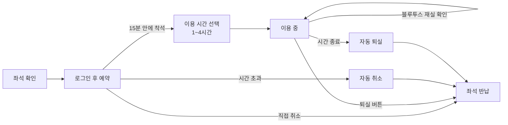
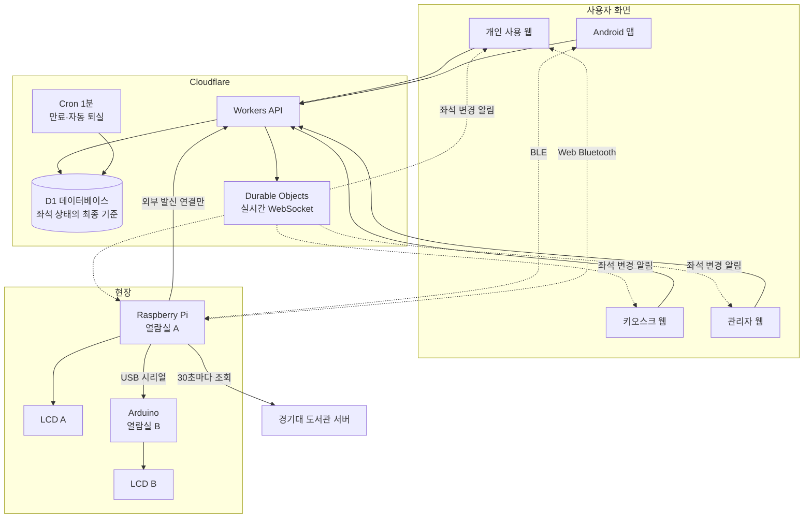

<div align="center">

# 📚 예비 도서관 좌석 시스템

### 시험기간, 자리 찾아 삼만리는 이제 그만.

중앙도서관이 꽉 찼을 때 여는 임시 열람실을<br/>
**가 보지 않아도 상황을 아는 곳**으로 바꾸는 좌석 예약·관리 시스템

[**개인 사용**](https://library-kiosk.kimkisoo0505.workers.dev/#/personal) ·
[**키오스크**](https://library-kiosk.kimkisoo0505.workers.dev/#/kiosk) ·
[**관리자**](https://library-kiosk.kimkisoo0505.workers.dev/#/admin) ·
[**서버 상태**](https://library-seat-api.kimkisoo0505.workers.dev/api/health)

| 90석 | 3개 열람실 | 15분 | 2시간 | 30초 | 5개 계층 |
|:---:|:---:|:---:|:---:|:---:|:---:|
| 실시간 관리 좌석 | A · B · C | 미착석 자동 취소 | 도서관 밖에 있으면<br/>자동 좌석 반납 | 중앙도서관 갱신 | 웹 · 클라우드 · 앱 · Pi · 아두이노 |

<sub>2시간: 열람실 A 블루투스 기준, 마지막 재실 확인 후 시간. 처음 고른 이용 시간이 더 남아 있으면 그 시간이 끝날 때 반납됩니다.</sub>

</div>

---

## 🤔 왜 만들었나요?

### 1. 기존 도서관 시스템 개선

도서관에는 자리 부족뿐만 아니라 입장과 퇴장 과정, 좌석 이용 규칙에서도 불편함이 있습니다.

- 🚶 입실과 퇴실을 처리하려면 매번 **키오스크 앞까지 직접 이동**해야 합니다.

- ⏳ 자리를 비우거나 이용을 마칠 때마다 키오스크를 찾아가야 하는 번거로움이 있습니다.

- 📋 이용 수칙을 정확히 알지 못해 **억울하게 패널티**를 받는 상황이 발생할 수 있습니다.

- 📱 현재 자리에서 휴대폰으로 처리하고, 블루투스가 열람실 안에 있는지 확인해 준다면 훨씬 편리하고 공정해집니다.

이 프로젝트는 모바일 앱과 키오스크, 좌석 시스템을 연동하여 입실과 퇴실의 불편을 줄이고, 사용자의 실제 이용 상황이 블루투스로 정확하게 반영되는 도서관을 목표로 합니다.

> **🎯 최종 목표: 그냥 와서 공부만 하세요.**
> 입장과 퇴장 여부는 앱과 키오스크 서버의 통신으로 자동 결정됩니다.
>
> **현재 단계:** 착석은 블루투스 범위 안에서 버튼으로 처리하고, 자리에 있는 동안 이용 시간이 자동 연장되며, 시간이 끝나면 자동 퇴실됩니다. 입장·퇴장 완전 자동화는 개발 예정입니다.

### 2. 시험기간 임시 도서관 운영

시험기간에는 중앙도서관이 빠르게 만석이 되어 강의실을 임시 열람실로 운영해야 하지만, 짧은 기간 동안 좌석을 관리하기는 쉽지 않습니다.

- 🏫 임시 열람실이 어디에 있고 빈자리가 얼마나 남았는지 **직접 가 보기 전에는 알기 어렵습니다.**

- 🎒 겨우 찾은 빈자리에 **가방만 놓여 있고** 주인은 오랫동안 돌아오지 않는 유령 좌석이 생깁니다.

- 🧑‍💼 강의실마다 위치와 좌석 구조가 다르고, 열람실마다 관리 인력을 두기도 어렵습니다.

- 🔧 소형 장치와 클라우드로 간단히 설치하고 원격으로 관리할 수 있다면 임시 열람실도 체계적으로 운영할 수 있습니다.

이 프로젝트는 실시간 좌석 현황과 자동 취소·퇴실, 원격 관리 기능을 연동하여 임시 열람실을 **가 보지 않아도 상황을 아는 곳**으로 만들고, 적은 인력으로도 쉽게 운영하는 것을 목표로 합니다.

## 목차

1. [기능 현황](#1-기능-현황)
2. [이용 흐름](#2-이용-흐름)
3. [좌석 기능](#3-좌석-기능)
4. [블루투스 기능](#4-블루투스-기능)
5. [알림 기능](#5-알림-기능)
6. [기록과 주변 정보](#6-기록과-주변-정보)
7. [화면과 계정](#7-화면과-계정)
8. [관리자 기능](#8-관리자-기능)
9. [현장 장치와 앱](#9-현장-장치와-앱)
10. [시스템 구조](#10-시스템-구조)
11. [사용 기술](#11-사용-기술)
12. [API와 데이터베이스](#12-api와-데이터베이스)
13. [안정성과 보안](#13-안정성과-보안)
14. [현재 한계와 계획](#14-현재-한계와-계획)
15. [개발과 배포](#15-개발과-배포)

---

## 1. 기능 현황

상태: ✅ 운영 중 · 🧪 시험 단계 · 🚧 예정 · ⏸️ 보류

| 번호 | 분류 | 기능 | 상태 |
|:---:|---|---|:---:|
| 3.1 | 좌석 | 실시간 좌석 현황 | ✅ |
| 3.2 | 좌석 | 좌석 예약과 취소 | ✅ |
| 3.3 | 좌석 | 착석과 이용 시간 선택 | ✅ |
| 3.4 | 좌석 | 퇴실과 자동 퇴실 | ✅ |
| 3.5 | 좌석 | 미착석 자동 취소 | ✅ |
| 4.1 | 블루투스 | 범위 안 착석 확인 (열람실 A) | 🧪 |
| 4.2 | 블루투스 | 재실 자동 연장 (열람실 A) | 🧪 |
| 5.1 | 알림 | 알림 팝업 | ✅ |
| 5.2 | 알림 | 브라우저 알림 | ✅ |
| 6.1 | 기록 | 이용 기록과 공부 시간 | ✅ |
| 6.2 | 주변 정보 | 중앙·금화도서관 잔여석 | ✅ |
| 6.3 | 주변 정보 | 가장 가까운 열람실 찾기 | ✅ |
| 7.1 | 화면 | 개인 사용·키오스크·관리자 화면 | ✅ |
| 7.2 | 계정 | 학생·관리자 인증 분리 | ✅ |
| 8.1 | 관리자 | 이용 통계 | ✅ |
| 8.2 | 관리자 | 좌석 상태 관리 | ✅ |
| 8.3 | 관리자 | 좌석 배치 편집 | ✅ |
| 8.4 | 관리자 | 강의실 위치 입력 | ✅ |
| 8.5 | 관리자 | 현장 장치 관리 | ✅ |
| 8.6 | 관리자 | 이벤트 로그 | ✅ |
| 9.1 | 현장 | 열람실 입구 LCD (A·B) | ✅ |
| 9.2 | 현장 | 라즈베리파이 에이전트 | ✅ |
| 9.3 | 현장 | 아두이노 컨트롤러 (B) | ✅ |
| 9.4 | 앱 | Android 앱 | 🧪 |
| – | 현장 | 열람실 C LCD | 🚧 |
| – | 화면 | 좌석 조건 필터, 빈자리 추천 | 🚧 |
| – | 현장 | 입구 카메라·숫자 키패드 입장 확인 | 🚧 |
| – | 현장 | 지문 센서 | ⏸️ |

---

## 2. 이용 흐름



| 예약 상태 | 의미 | 다음 상태 |
|---|---|---|
| `reserved` | 예약됨, 착석 대기 | `occupied`, `cancelled`, `expired` |
| `occupied` | 착석하여 이용 중 | `completed` |
| `completed` | 퇴실 완료 | 종료 |
| `cancelled` | 학생 또는 관리자가 취소 | 종료 |
| `expired` | 착석 기한 초과 | 종료 |

---

> 아래 3~9장의 기능은 모두 **목적 · 사용 방법 · 동작 규칙 · 사용 기술 · 구현 위치** 형식으로 설명합니다.

## 3. 좌석 기능

### 3.1 실시간 좌석 현황

| 항목 | 내용 |
|---|---|
| **목적** | 열람실에 가지 않고 남은 자리와 위치를 확인합니다. |
| **사용 방법** | 열람실 탭(A·B·C)을 누르고 배치도에서 좌석을 선택합니다. 로그인 없이 볼 수 있습니다. |
| **동작 규칙** | 좌석은 이용 가능·예약됨·사용 중·점검 중·내 좌석으로 표시합니다.<br/>좌석이 바뀌면 모든 화면에 즉시 반영하고, 실시간 연결이 끊기면 30초마다 다시 조회합니다.<br/>실시간 알림에는 좌석 번호와 변경 사유만 담깁니다. |
| **사용 기술** | Durable Objects, WebSocket Hibernation API, D1 |
| **구현 위치** | [seats.js](cloudflare/workers/seats.js), [seat-room.js](cloudflare/workers/durable-objects/seat-room.js), [websocket.js](web/kiosk/src/common/websocket.js) |

### 3.2 좌석 예약과 취소

| 항목 | 내용 |
|---|---|
| **목적** | 원하는 자리를 미리 확보하고, 필요 없으면 바로 돌려줍니다. |
| **사용 방법** | 좌석 선택 → [예약하기]. 취소는 상태 카드의 [예약 취소]를 누릅니다. |
| **동작 규칙** | 한 학생은 열람실 전체에서 활성 좌석 1개만 가질 수 있습니다.<br/>같은 좌석을 동시에 눌러도 한 명만 성공합니다.<br/>점검 중인 좌석은 예약할 수 없고, 서버 연결이 끊기면 예약 버튼을 막습니다. |
| **사용 기술** | D1 부분 UNIQUE 인덱스, 조건부 `INSERT ... SELECT ... WHERE` |
| **구현 위치** | [reservations.js](cloudflare/workers/reservations.js) |

### 3.3 착석과 이용 시간 선택

| 항목 | 내용 |
|---|---|
| **목적** | 실제 이용을 시작하고 사용할 시간을 정합니다. |
| **사용 방법** | [착석했어요] → 1·2·3·4시간 중 선택합니다. |
| **동작 규칙** | 착석 기한 안의 본인 예약만 처리합니다.<br/>이용 종료 시각은 `착석 시각 + 선택 시간`입니다.<br/>착석하면 해당 열람실 LCD에 `Welcome`이 표시됩니다. |
| **사용 기술** | 조건부 `UPDATE ... WHERE status = 'reserved' RETURNING` |
| **구현 위치** | [reservations.js](cloudflare/workers/reservations.js), [personal/home.js](web/kiosk/src/personal/home.js), [kiosk/home.js](web/kiosk/src/kiosk/home.js) |

### 3.4 퇴실과 자동 퇴실

| 항목 | 내용 |
|---|---|
| **목적** | 다 쓴 자리를 다음 사람에게 바로 돌려줍니다. |
| **사용 방법** | [퇴실하기]를 누르거나, 이용 시간이 끝나기를 기다립니다. |
| **동작 규칙** | 이용 종료 시각이 지나면 1분 주기 작업이 자동 퇴실(`time_expired`)로 처리합니다.<br/>처리 시점은 종료 시각보다 최대 약 1분 늦을 수 있지만, 공부 시간은 종료 시각까지만 계산합니다. |
| **사용 기술** | Cloudflare Cron Triggers, 조건부 `UPDATE` |
| **구현 위치** | [reservations.js](cloudflare/workers/reservations.js), [index.js](cloudflare/workers/index.js) |

### 3.5 미착석 자동 취소

| 항목 | 내용 |
|---|---|
| **목적** | 예약만 해 두고 오지 않는 유령 좌석을 막습니다. |
| **사용 방법** | 별도 조작이 없습니다. 상태 카드에 착석 마감까지 남은 시간이 표시됩니다. |
| **동작 규칙** | 예약 후 15분 안에 착석하지 않으면 `expired`로 바꾸고 좌석을 반납합니다.<br/>1분 주기 작업과 새 예약 요청 직전에 만료를 처리합니다. |
| **사용 기술** | Cloudflare Cron Triggers, 환경 변수 `RESERVATION_HOLD_MINUTES` |
| **구현 위치** | [reservations.js](cloudflare/workers/reservations.js) |

---

## 4. 블루투스 기능

### 4.1 범위 안 착석 확인

| 항목 | 내용 |
|---|---|
| **목적** | 열람실 밖에서 습관적으로 착석 버튼을 누르는 일을 줄입니다. |
| **사용 방법** | 열람실 A 예약 후 [블루투스로 착석 확인 켜기] → `LIB-SEAT-PI` 선택. 앱은 자동으로 연결합니다. |
| **동작 규칙** | 개인 사용 화면과 앱에서 범위 안일 때만 [착석]이 활성화됩니다.<br/>앱은 RSSI −85 dBm 이상, 웹은 연결 상태에서 최근 25초 안의 `PONG`을 기준으로 판단합니다.<br/>열람실 B·C와 키오스크 모드는 예외입니다.<br/>**화면에서 막는 기능이며 서버는 근접 여부를 검증하지 않습니다.** |
| **사용 기술** | BLE GATT, Web Bluetooth, Flutter BLE |
| **구현 위치** | [web-ble.js](web/kiosk/src/personal/web-ble.js), [app-bridge.js](web/kiosk/src/personal/app-bridge.js), [presence_service.dart](mobile-app/lib/services/presence_service.dart), [ble_server.py](raspberry-pi/agent/ble_server.py) |

### 4.2 재실 자동 연장

| 항목 | 내용 |
|---|---|
| **목적** | 자리에 있는 학생이 연장을 신경 쓰지 않고 공부하게 합니다. |
| **사용 방법** | 이용 중 앱이나 개인 사용 화면을 켜 두고 블루투스를 연결합니다. |
| **동작 규칙** | 범위 안이면 1분에 최대 한 번 재실을 보고합니다.<br/>남은 시간이 2시간 미만이면 2시간으로 올리고, 이미 끝난 예약은 연장하지 않습니다.<br/>웹은 10초마다 `PING`을 보내고, 끊기면 2·4·8·16·30초 간격으로 최대 10회 재연결합니다. |
| **사용 기술** | BLE GATT, Web Bluetooth, REST API |
| **구현 위치** | [reservations.js](cloudflare/workers/reservations.js), [web-ble.js](web/kiosk/src/personal/web-ble.js), [ble_protocol.py](raspberry-pi/agent/ble_protocol.py), [BLE 규격](docs/BLE_GATT_SPEC.md) |

**지원 환경**

| 환경 | 착석 확인·자동 연장 | 판단 방식 |
|---|:---:|---|
| Android 앱 | 지원 | RSSI 신호 세기 |
| Android Chrome · Edge · 삼성 인터넷 | 지원 | GATT 연결 + PING/PONG |
| iPhone Safari · Firefox | 미지원 | 입구 키오스크 이용 |

---

## 5. 알림 기능

### 5.1 알림 팝업

| 항목 | 내용 |
|---|---|
| **목적** | 중요한 결과와 마감 시각을 놓치지 않게 합니다. |
| **사용 방법** | 조건이 되면 화면 가운데 표시되며 [확인], Esc, 바깥 영역으로 닫습니다. |
| **동작 규칙** | 여러 알림은 순서대로 표시합니다.<br/>개인 사용 화면은 아래 모든 상황을 알리고, 키오스크는 내 동작 완료만 알린 뒤 8초 후 자동으로 닫습니다. |
| **사용 기술** | Vanilla JS, ARIA `alertdialog`, WebSocket 상태 변화 감지 |
| **구현 위치** | [popup.js](web/kiosk/src/common/popup.js), [seat-alerts.js](web/kiosk/src/common/seat-alerts.js) |

| 알림 시점 | 내용 | 개인 사용 | 키오스크 |
|---|---|:---:|:---:|
| 내 동작 완료 | 예약·착석·퇴실·예약 취소 | ✅ | ✅ |
| 착석 마감 5분 전 | 마감 시각, 자동 취소 안내 | ✅ | – |
| 이용 종료 10분 전 | 자동 퇴실 시각 안내 | ✅ | – |
| 서버 자동 처리 | 미착석 자동 취소, 시간 종료 퇴실 | ✅ | – |
| 관리자 조치 | 좌석 강제 해제 | ✅ | – |
| 다른 기기 처리 | 착석·취소·퇴실 | ✅ | – |

### 5.2 브라우저 알림

| 항목 | 내용 |
|---|---|
| **목적** | 다른 탭이나 앱을 보는 동안에도 좌석 변화를 알려 줍니다. |
| **사용 방법** | '내 이용' 탭의 [브라우저 알림 켜기] 또는 예약 완료 팝업의 [알림 받기]를 누릅니다. |
| **동작 규칙** | 화면을 보고 있으면 팝업만 띄우고, 보고 있지 않을 때만 브라우저 알림을 보냅니다.<br/>알림을 누르면 좌석 화면으로 돌아옵니다.<br/>페이지가 열려 있는 동안만 동작하며 앱과 iPhone Safari에서는 사용할 수 없습니다. |
| **사용 기술** | Notification API, Service Worker |
| **구현 위치** | [browser-notify.js](web/kiosk/src/common/browser-notify.js), [sw.js](web/kiosk/public/sw.js) |

---

## 6. 기록과 주변 정보

### 6.1 이용 기록과 공부 시간

| 항목 | 내용 |
|---|---|
| **목적** | 자신의 공부량과 이용 습관을 확인합니다. |
| **사용 방법** | 하단의 [내 이용] 탭을 엽니다. |
| **제공 정보** | 총 공부 시간, 오늘, 최근 7일, 연속 공부 일수, 7일 그래프<br/>자주 앉는 자리, 평균·최장 이용 시간, 예약 횟수, 미착석 자동 취소 횟수<br/>좌석·날짜·시작/종료 시각·이용 시간·종료 사유가 담긴 이용 기록 |
| **동작 규칙** | 공부 시간은 착석부터 퇴실까지이며 이용 종료 시각을 넘지 않습니다.<br/>날짜는 한국 시간 기준이고, 자정을 넘긴 이용은 두 날짜에 나눕니다. |
| **사용 기술** | D1 집계 데이터, REST API, CSS 막대 그래프 |
| **구현 위치** | [stats.js](cloudflare/workers/stats.js), [study-stats.js](web/kiosk/src/common/study-stats.js) |

### 6.2 중앙·금화도서관 잔여석

| 항목 | 내용 |
|---|---|
| **목적** | 임시 열람실이 찼을 때 다른 도서관을 바로 비교합니다. |
| **사용 방법** | 하단의 [중앙도서관] 탭을 엽니다. |
| **동작 규칙** | 라즈베리파이가 30초마다 학교 서버를 조회해 우리 서버로 전달합니다.<br/>`잔여석 = 전체 − (사용 중 + 이용불가 + 고정석 + 비활성 + 지정석)`<br/>`사용률 = 사용 중 ÷ 실제 이용 가능 좌석`<br/>10분 넘게 새 값이 없으면 오래된 정보임을 표시합니다. |
| **사용 기술** | Python httpx, TLS 인증서 체인 보완, D1 캐시 |
| **구현 위치** | [library_status.py](raspberry-pi/agent/library_status.py), [central-library.js](cloudflare/workers/central-library.js) |

### 6.3 가장 가까운 열람실 찾기

| 항목 | 내용 |
|---|---|
| **목적** | 지금 위치에서 빈자리가 있는 곳을 빠르게 찾습니다. |
| **사용 방법** | [내 위치로 가까운 열람실 찾기] → 위치 권한 허용 → [카카오맵 길찾기] |
| **동작 규칙** | 열람실 A·B·C와 중앙도서관 중 빈자리가 있는 가장 가까운 곳을 추천합니다.<br/>거리는 직선거리 기준의 어림값입니다.<br/>위치는 휴대폰 안의 계산에만 쓰고 서버로 보내지 않습니다. |
| **사용 기술** | Geolocation API, Kakao Maps JavaScript SDK |
| **구현 위치** | [nearby.js](web/kiosk/src/personal/nearby.js), [geo.js](web/kiosk/src/personal/geo.js), [kakao-map.js](web/kiosk/src/personal/kakao-map.js), [nearby-card.js](web/kiosk/src/personal/components/nearby-card.js) |

---

## 7. 화면과 계정

### 7.1 개인 사용·키오스크·관리자 화면

| 항목 | 내용 |
|---|---|
| **목적** | 사용하는 기기와 사람에 맞는 기능만 보여 줍니다. |
| **사용 방법** | 화면 맨 위의 [개인 사용 \| 키오스크 \| 관리자]로 이동합니다. |
| **동작 규칙** | 기본 주소는 휴대폰에서 개인 사용, PC에서 키오스크로 열립니다.<br/>앱에서는 개인 사용 화면만 표시합니다. |
| **사용 기술** | Hash 라우팅, 반응형 CSS, Vanilla JS 컴포넌트 |
| **구현 위치** | [routes.js](web/kiosk/src/common/routes.js), [usage-mode.js](web/kiosk/src/common/usage-mode.js), [personal](web/kiosk/src/personal), [kiosk](web/kiosk/src/kiosk), [admin](web/kiosk/src/admin) |

| 비교 항목 | 개인 사용 | 키오스크 | 관리자 |
|---|:---:|:---:|:---:|
| 대상 | 본인 휴대폰 | 입구 공용 기기 | 관리자 |
| 좌석 예약·착석·퇴실 | ✅ | ✅ | – |
| 이용 기록·공부 시간 | ✅ | ✅ | – |
| 블루투스 | ✅ | – | – |
| 가까운 열람실 찾기 | ✅ | – | – |
| 브라우저 알림 | ✅ | – | – |
| 자동 로그아웃 | 없음 | 90초 | 없음 |
| 좌석·장치·통계 관리 | – | – | ✅ |

### 7.2 학생·관리자 인증 분리

| 항목 | 내용 |
|---|---|
| **목적** | 학생 권한과 관리자 권한이 섞이지 않게 합니다. |
| **사용 방법** | 학생은 학번과 비밀번호, 관리자는 아이디와 비밀번호로 로그인합니다. |
| **동작 규칙** | 테이블, 로그인 엔드포인트, 세션 종류를 분리합니다.<br/>세션은 12시간 유지되며 본인 예약만 변경할 수 있습니다. |
| **사용 기술** | PBKDF2-SHA256(100,000회), 32바이트 무작위 토큰, SHA-256 토큰 해시 |
| **구현 위치** | [auth.js](cloudflare/workers/auth.js), [accounts.mjs](cloudflare/scripts/accounts.mjs) |

---

## 8. 관리자 기능

### 8.1 이용 통계

| 항목 | 내용 |
|---|---|
| **목적** | 열람실 이용량과 노쇼를 파악해 운영에 활용합니다. |
| **사용 방법** | 관리자 화면의 [이용 통계]에서 7·14·30일을 선택합니다. |
| **제공 정보** | 총 공부 시간, 평균 이용 시간, 착석, 예약, 이용 학생 수, 노쇼 수·비율, 예약 취소<br/>일별 공부 시간 그래프, 시간대별 평균 사용 좌석 그래프, 열람실별 표, 일별 숫자 표 |
| **동작 규칙** | 한국 날짜 기준으로 집계합니다.<br/>학생별 순위와 학번은 제공하지 않습니다. |
| **사용 기술** | D1 인덱스 조회, 서버 집계, CSS 막대 그래프 |
| **구현 위치** | [stats.js](cloudflare/workers/stats.js), [stats-panel.js](web/kiosk/src/admin/components/stats-panel.js) |

### 8.2 좌석 상태 관리

| 항목 | 내용 |
|---|---|
| **목적** | 고장 좌석과 문제가 생긴 예약을 현장에서 처리합니다. |
| **사용 방법** | [좌석 관리] 표에서 [점검 전환], [사용 재개], [예약 해제]를 누릅니다. |
| **동작 규칙** | 활성 예약이 있는 좌석은 점검으로 전환할 수 없습니다.<br/>예약 강제 해제는 사유 입력이 필수이며 이벤트 로그에 남습니다. |
| **사용 기술** | 관리자 세션 검증, 조건부 `UPDATE` |
| **구현 위치** | [seats.js](cloudflare/workers/seats.js), [reservations.js](cloudflare/workers/reservations.js), [admin.js](web/kiosk/src/admin/admin.js) |

### 8.3 좌석 배치 편집

| 항목 | 내용 |
|---|---|
| **목적** | 학생 화면의 배치도를 실제 강의실과 같게 맞춥니다. |
| **사용 방법** | [배치 편집] → 좌석과 출입구·칠판·창가를 드래그 → [저장] |
| **동작 규칙** | 줄·칸은 3~15, 표시 블록은 최대 12개입니다.<br/>좌석 수와 번호는 바꾸지 않고 위치만 저장합니다.<br/>버전 비교로 두 관리자의 저장 충돌을 막습니다. |
| **사용 기술** | Pointer Events, CSS Grid, JSON 레이아웃 검증 |
| **구현 위치** | [layout.js](cloudflare/workers/layout.js), [layout-editor.js](web/kiosk/src/admin/components/layout-editor.js) |

### 8.4 강의실 위치 입력

| 항목 | 내용 |
|---|---|
| **목적** | 열람실의 실제 위치를 일관된 형식으로 안내합니다. |
| **사용 방법** | 건물 목록에서 선택 → 숫자 키패드로 호실 입력 → [저장] |
| **동작 규칙** | 수원캠퍼스 건물 31곳을 제공하고 호실은 숫자 5자리까지 입력합니다.<br/>저장한 위치는 학생 화면과 가까운 열람실 찾기에 사용됩니다. |
| **사용 기술** | 건물 좌표표, 서버 입력 검증 |
| **구현 위치** | [location-picker.js](web/kiosk/src/admin/components/location-picker.js), [campus-buildings.js](web/kiosk/src/common/campus-buildings.js), [seats.js](cloudflare/workers/seats.js) |

### 8.5 현장 장치 관리

| 항목 | 내용 |
|---|---|
| **목적** | 현장에 가지 않고 장치 상태를 확인합니다. |
| **사용 방법** | [현장 장치]에서 연결 상태를 보고, 필요하면 [라즈베리파이 끄기]를 누릅니다. |
| **동작 규칙** | 최근 90초 안에 보고한 장치를 연결됨으로 표시합니다.<br/>원격 종료는 확인 창과 `끄기` 입력의 2단계 확인이 필요합니다.<br/>명령은 60초 뒤 만료되고, 장치는 열람실·만료·중복·허용 설정을 확인한 뒤 실행합니다. |
| **사용 기술** | Durable Objects 장치 전용 채널, polkit |
| **구현 위치** | [system-status.js](cloudflare/workers/system-status.js), [device_status.py](raspberry-pi/agent/device_status.py), [remote_command.py](raspberry-pi/agent/remote_command.py) |

### 8.6 이벤트 로그

| 항목 | 내용 |
|---|---|
| **목적** | 예약 처리와 장애의 원인을 추적합니다. |
| **사용 방법** | 관리자 화면의 [최근 이벤트]에서 최근 50건을 확인합니다. |
| **동작 규칙** | 예약, 착석, 퇴실, 만료, 관리자 조치, 장치 이벤트를 기록합니다.<br/>비밀번호와 토큰은 기록하지 않습니다. |
| **사용 기술** | D1 `events` 테이블, 에이전트 JSON 로그 |
| **구현 위치** | [router.js](cloudflare/workers/router.js), [logger.py](raspberry-pi/agent/logger.py) |

---

## 9. 현장 장치와 앱

| 열람실 | 제어 장치 | LCD | 연결 | 상태 |
|:---:|---|---|---|:---:|
| **A** | Raspberry Pi 3 B+ | Grove LCD RGB Backlight (0x3E, 0x62) | I2C | ✅ |
| **B** | Arduino UNO R3 | I2C 16x2 LCD (0x3F) | Pi와 USB 시리얼 | ✅ |
| **C** | Arduino UNO R3 | 미정 | Pi와 USB 시리얼 | 🚧 |

### 9.1 열람실 입구 LCD

```
┌────────────────┐        ┌────────────────┐        ┌────────────────┐
│Welcome         │  2초   │Welco           │   …    │                │
│Use 4 Free 26   │  ───▶  │Use 4 Free 26   │  ───▶  │Use 4 Free 26   │
└────────────────┘        └────────────────┘        └────────────────┘
```

| 항목 | 내용 |
|---|---|
| **목적** | 입구에서 열람실 상황을 바로 보여 줍니다. |
| **사용 방법** | 별도 조작 없이 표시됩니다. |
| **동작 규칙** | 1줄: 착석 시 `Welcome` 2초 표시 후 0.15초 간격으로 한 글자씩 지웁니다.<br/>2줄: `Use 사용중 Free 빈자리`를 표시합니다.<br/>서버 미연결·오래된 정보는 `Offline`으로 표시하고, A는 배경을 빨간색으로 바꿉니다. |
| **사용 기술** | I2C, smbus2, Grove RGB LCD, PCF8574 |
| **구현 위치** | [room_display.py](raspberry-pi/agent/room_display.py), [lcd_display.py](raspberry-pi/agent/lcd_display.py) |

### 9.2 라즈베리파이 에이전트

| 항목 | 내용 |
|---|---|
| **목적** | 클라우드와 현장 장치를 연결합니다. |
| **사용 방법** | 전원을 켜면 `library-agent`, `library-ble` 서비스가 실행됩니다. |
| **동작 규칙** | 서버 실시간 연결 유지, LCD 갱신, 학교 잔여석 30초 중계, 장치 상태 30초 보고를 담당합니다.<br/>외부 발신 연결만 사용하며, 네트워크가 끊기면 신규 예약을 승인하지 않습니다.<br/>기본 와이파이가 없으면 등록된 휴대폰 핫스팟으로 연결합니다. |
| **사용 기술** | Python 3.13, asyncio, httpx, websockets, bless, systemd, NetworkManager |
| **구현 위치** | [main.py](raspberry-pi/agent/main.py), [cloud_client.py](raspberry-pi/agent/cloud_client.py), [config.py](raspberry-pi/agent/config.py) |

### 9.3 아두이노 컨트롤러

| 항목 | 내용 |
|---|---|
| **목적** | 라즈베리파이가 없는 열람실의 LCD를 제어합니다. |
| **사용 방법** | Pi와 USB로 연결하면 자동으로 동작합니다. |
| **동작 규칙** | Pi가 화면을 계산해 변경 시와 10초마다 보내고, 아두이노는 표시만 합니다.<br/>30초 동안 명령이 없으면 스스로 `Offline`을 표시합니다.<br/>서보 명령은 펌웨어와 에이전트에서 모두 거부합니다. |
| **사용 기술** | Arduino UNO R3, 115200bps 줄 단위 ASCII 프로토콜, I2C |
| **구현 위치** | [room_lcd.ino](arduino/firmware/room_lcd/room_lcd.ino), [arduino_rooms.py](raspberry-pi/agent/arduino_rooms.py), [시리얼 규격](arduino/protocol/SERIAL_PROTOCOL.md) |

### 9.4 Android 앱

| 항목 | 내용 |
|---|---|
| **목적** | 웹 화면과 정밀한 블루투스 재실 확인을 하나의 앱으로 제공합니다. |
| **사용 방법** | 앱 실행 → 로그인 → 열람실 A 예약·이용 시 블루투스가 자동으로 동작합니다. |
| **동작 규칙** | 개인 사용 웹 화면을 WebView로 표시합니다.<br/>RSSI를 5초마다 측정하고 15초 이내 값이 −85 dBm 이상일 때 범위 안으로 판단합니다.<br/>로그인 토큰은 웹이 관리하며 앱의 블루투스 영역으로 넘기지 않습니다. |
| **사용 기술** | Flutter, flutter_reactive_ble, webview_flutter, permission_handler |
| **구현 위치** | [web_app_screen.dart](mobile-app/lib/screens/web_app_screen.dart), [presence_service.dart](mobile-app/lib/services/presence_service.dart), [ble_service.dart](mobile-app/lib/services/ble_service.dart) |

---

## 10. 시스템 구조



| 계층 | 역할 | 데이터 기준 |
|---|---|---|
| 웹·앱 | 화면 표시, 사용자 입력, 블루투스 상태 확인 | 서버 값의 캐시 |
| Workers | 인증, 예약 처리, 통계, 장치 API | 요청 처리 |
| D1 | 계정, 좌석, 예약, 이벤트, 외부 데이터 저장 | **최종 기준** |
| Durable Objects | 실시간 연결 관리, 변경 알림, 장치 명령 전달 | 상태 저장 안 함 |
| 라즈베리파이 | LCD, BLE, 학교 데이터 중계, 장치 보고 | 서버 값의 캐시 |
| 아두이노 | LCD 표시 | 받은 화면만 표시 |

---

## 11. 사용 기술

| 영역 | 기술 | 버전 | 사용 위치 | 선택 이유 |
|---|---|---|---|---|
| **프론트엔드** | JavaScript (ES Modules) | ES2020+ | 모든 웹 화면 | 프레임워크 없이 가볍게 구성 |
| | Vite | 7.3.7 | 개발 서버, 빌드 | 빠른 개발과 번들링 |
| | CSS Grid / Flexbox | – | 배치도, 반응형 화면 | 휴대폰과 PC 모두 지원 |
| **브라우저 API** | WebSocket | – | 실시간 좌석 갱신 | 조회 없이 즉시 반영 |
| | Web Bluetooth | – | 모바일 웹 재실 확인 | 앱 없이 BLE 연결 |
| | Notification / Service Worker | – | 브라우저 알림 | Android Chrome 알림 지원 |
| | Geolocation | – | 가까운 열람실 찾기 | 현재 위치 기반 추천 |
| **지도** | Kakao Maps JavaScript SDK | – | 지도, 길찾기 연결 | 국내 지도와 장소 정보 |
| **백엔드** | Cloudflare Workers | compat 2025-09-01 | REST API | 서버 관리 없는 엣지 실행 |
| | Cloudflare Cron Triggers | 1분 주기 | 만료·자동 퇴실 | 접속자가 없어도 상태 정리 |
| | Durable Objects | Hibernation API | WebSocket 허브 | 연결 상태를 한곳에서 관리 |
| **데이터베이스** | Cloudflare D1 (SQLite) | 마이그레이션 0001~0008 | 계정, 예약, 이벤트 | 조건부 SQL로 원자적 처리 |
| **현장 에이전트** | Python | 3.13 | 라즈베리파이 | asyncio 기반 장치 제어 |
| | httpx | 0.27 이상 | REST 호출 | 비동기 HTTPS |
| | websockets | 14 이상 | 실시간 구독 | 외부 발신 WSS |
| | pyserial | 3.5 이상 | 아두이노 통신 | USB 시리얼 |
| | smbus2 | 0.4 이상 | LCD | 순수 Python I2C |
| | bless | 0.3.0 | BLE GATT 서버 | BlueZ 기반 Peripheral |
| **하드웨어** | Raspberry Pi 3 B+ | Pi OS Lite 32-bit | 열람실 A | 현장 서버 겸 BLE 장치 |
| | Arduino UNO R3 | ATmega328P | 열람실 B | LCD 전용 컨트롤러 |
| | Grove RGB LCD, I2C 16x2 LCD | – | 입구 표시 | 상태를 색과 글자로 표시 |
| **모바일 앱** | Flutter / Dart | 3.47.9 / 3.13.7 | Android 앱 | 빠른 앱 구현 |
| | flutter_reactive_ble | 5.6.0 | BLE 연결, RSSI | 안정적인 BLE Central |
| | webview_flutter | 4.14.1 | 웹 화면 표시 | 웹 기능 재사용 |
| | permission_handler | 13.0.2 | Android 권한 | 블루투스 권한 처리 |
| **배포·도구** | GitHub Actions | – | 검사와 자동 배포 | push 기반 배포 |
| | Wrangler | 4.157.0 | Workers, D1 배포 | Cloudflare 공식 도구 |
| | Node.js test runner | – | Worker·웹 테스트 | 추가 의존성 없음 |
| | Python unittest | – | 에이전트 테스트 | 하드웨어 없이 실행 |

---

## 12. API와 데이터베이스

### REST API

기본 경로: `https://library-seat-api.kimkisoo0505.workers.dev/api` · 전체 명세: [API_SPEC.md](docs/API_SPEC.md)

| 분류 | 메서드 | 경로 | 설명 | 권한 |
|---|---|---|---|---|
| 상태 | GET | `/health` | 서버 상태 | 공개 |
| | GET | `/system-status` | 장치·외부 연동 상태 | 공개 |
| 인증 | POST | `/auth/login` | 학생 로그인 | 공개 |
| | POST | `/admin/login` | 관리자 로그인 | 공개 |
| | POST | `/auth/logout` | 로그아웃 | 세션 |
| | GET | `/auth/me` | 내 정보 | 세션 |
| 좌석 | GET | `/seats` | 좌석 현황 | 공개 |
| | GET | `/central-library` | 중앙·금화도서관 잔여석 | 공개 |
| 예약 | POST | `/reservations` | 예약 | 학생 |
| | GET | `/reservations/me` | 내 활성 예약 | 학생 |
| | DELETE | `/reservations/:id` | 예약 취소 | 학생 |
| | POST | `/reservations/:id/check-in` | 착석 | 학생 |
| | POST | `/reservations/:id/check-out` | 퇴실 | 학생 |
| | POST | `/reservations/me/presence` | 재실 확인 | 학생 |
| 기록 | GET | `/reservations/me/stats` | 내 통계 | 학생 |
| | GET | `/reservations/me/history` | 내 이용 기록 | 학생 |
| 관리자 | GET | `/admin/seats` | 좌석·예약 상세 | 관리자 |
| | POST | `/admin/seats/:id/status` | 점검 전환 | 관리자 |
| | POST | `/admin/rooms/:code/location` | 강의실 위치 저장 | 관리자 |
| | POST | `/admin/rooms/:code/layout` | 좌석 배치 저장 | 관리자 |
| | POST | `/admin/reservations/:id/release` | 예약 강제 해제 | 관리자 |
| | GET | `/admin/stats` | 이용 통계 | 관리자 |
| | GET | `/admin/events` | 이벤트 로그 | 관리자 |
| | POST | `/admin/devices/:room/shutdown` | Pi 원격 종료 | 관리자 |
| 장치 | POST | `/device/events` | 장치 이벤트 | 장치 토큰 |
| | POST | `/device/central-library` | 잔여석 중계 | 장치 토큰 |
| | POST | `/device/status` | 장치 상태 보고 | 장치 토큰 |
| 실시간 | GET | `/ws` | WebSocket | 공개 / 장치 |

### 데이터베이스

전체 설계: [DATABASE.md](docs/DATABASE.md)

| 테이블 | 저장 내용 | 주요 제약 |
|---|---|---|
| `students` | 학생 계정 | 학번 UNIQUE, 비밀번호 해시 |
| `admins` | 관리자 계정 | 아이디 UNIQUE, 학생과 분리 |
| `sessions` | 로그인 세션 | 토큰 해시 UNIQUE, 세션 종류 구분 |
| `rooms` | 열람실, 위치, 배치 | 코드 UNIQUE, 배치 버전 |
| `seats` | 90개 좌석과 관리 상태 | 전체 고유 id (A 1~30, B 31~60, C 61~90) |
| `reservations` | 예약·이용 기록 | 좌석별·학생별 활성 예약 1건 |
| `events` | 감사 로그 | 비밀번호·토큰 저장 금지 |
| `external_snapshots` | 학교 잔여석 캐시 | 출처별 1행 |
| `device_status` | 장치 최근 상태 | 장치별 1행 |

---

## 13. 안정성과 보안

| 영역 | 위험 | 대응 |
|---|---|---|
| **중복 예약** | 같은 좌석 동시 요청 | 부분 UNIQUE 인덱스와 조건부 SQL |
| **상태 변경** | 오래된 요청의 덮어쓰기 | 이전 상태가 맞을 때만 `UPDATE` |
| **네트워크 장애** | 오프라인 중 잘못된 승인 | 신규 예약 거부, LCD `Offline` |
| **아두이노 단절** | 좌석 상태 오염 | 로그만 남기고 좌석 상태 유지 |
| **장치 정지** | LCD의 틀린 숫자 표시 | 아두이노 30초 감시 타이머 |
| **비밀번호** | DB 유출 | PBKDF2-SHA256 해시 저장 |
| **세션 토큰** | 토큰 탈취 | 원문 미저장, SHA-256 해시 저장 |
| **권한** | 학생의 관리자 기능 접근 | 테이블·로그인·세션 종류 분리 |
| **XSS** | 사용자·외부 데이터 삽입 | `textContent` 사용, CSP 적용 |
| **SQL 인젝션** | 입력값으로 쿼리 조작 | `prepare().bind()` 파라미터 바인딩 |
| **외부 데이터** | 학교·장치 응답 조작 | 서버에서 형식과 범위 재검증 |
| **장치 보안** | 현장 장치 외부 노출 | 외부 발신 연결만 사용, 포트포워딩 없음 |
| **서보모터** | 의도하지 않은 구동 | 펌웨어와 에이전트 이중 차단 |
| **개인정보** | 위치·이동 기록 수집 | 위치 미전송, 재실은 마지막 시각만 저장 |
| **데이터 복구** | 데이터 손상 | D1 Time Travel, [백업·복구 절차](docs/BACKUP_RESTORE.md) |

---

## 14. 현재 한계와 계획

### 현재 한계

| 항목 | 내용 |
|---|---|
| 블루투스 착석 확인 | 화면에서만 막으므로 키오스크 모드나 조작된 클라이언트로 우회할 수 있습니다. |
| 블루투스 적용 범위 | 현재 열람실 A만 지원합니다. |
| 블루투스 시험 | 착석 확인과 Web Bluetooth 흐름은 가짜 장치로 시험했으며 실제 기기 시험이 더 필요합니다. |
| 브라우저 알림 | 페이지가 열려 있는 동안만 동작합니다. |
| 로그인 보호 | 로그인 시도 횟수 제한이 없습니다. |
| 시연 설정 | 테스트 계정 안내가 화면에 표시됩니다. **실제 운영 전 반드시 끄고 비밀번호를 재설정해야 합니다.** |

### 앞으로의 계획

| 우선순위 | 계획 | 기대 효과 |
|:---:|---|---|
| 높음 | 로그인 시도 횟수 제한 | 비밀번호 대입 공격 방어 |
| 높음 | 서버가 검증하는 블루투스 일회용 코드 | 원격 착석 차단 |
| 중간 | Web Push | 페이지를 닫아도 알림 수신 |
| 중간 | 장시간 부재 시 사전 알림 후 자동 퇴실 | 유령 좌석 감소 |
| 중간 | 열람실 B·C 블루투스, 열람실 C LCD | 전체 열람실 동일 기능 |
| 낮음 | 좌석 조건 필터, 빈자리 추천 | 좌석 선택 편의 |
| 낮음 | 입구 카메라·숫자 키패드 | 현장 입장 확인 |
| 낮음 | 앱 내 위치·알림, 학교 SSO | 앱 기능과 계정 연동 확대 |
| 보류 | 지문 센서 | 생체정보 안전성 검토 후 결정 |

---

## 15. 개발과 배포

### 프로젝트 구조

```
library-project/
├─ cloudflare/      API 서버(workers), D1 스키마·마이그레이션(database), 테스트
├─ web/kiosk/       개인 사용(personal) · 키오스크(kiosk) · 관리자(admin) · 공용(common) 화면
├─ raspberry-pi/    현장 에이전트(agent), 테스트(tests), 서비스 설정(systemd, system)
├─ arduino/         펌웨어(firmware), 시리얼 프로토콜(protocol)
├─ mobile-app/      Flutter Android 앱
├─ docs/            설계, API, DB, 하드웨어, BLE, 백업, 업데이트 기록
└─ scripts/         개발 PC·라즈베리파이 환경 점검
```

### 로컬 실행 (Windows 11)

```powershell
# 환경 점검
powershell -ExecutionPolicy Bypass -File scripts\check_environment.ps1

# API 서버
cd cloudflare
npm install
copy wrangler.toml.example wrangler.toml     # 커밋 금지
npm run migrate:local
npm run dev                                   # http://127.0.0.1:8787

# 웹 화면 (/api 는 위 서버로 프록시)
cd web\kiosk
npm install
npm run dev                                   # http://localhost:5173
```

### 테스트

| 영역 | 명령 | 자동 테스트 |
|---|---|---:|
| Worker | `cd cloudflare; npm test` | 45개 |
| DB 스키마 | `cd cloudflare; python tests\check_schema.py` | 구조·제약 검사 |
| 웹 | `cd web\kiosk; npm test` | 48개 |
| 라즈베리파이 | `cd raspberry-pi; python -m unittest discover -s tests -t . -v` | 109개 |
| 모바일 앱 | `cd mobile-app; flutter test` | 테스트 파일 7개 |

### 배포

`main` 브랜치에 push하면 변경된 영역만 운영에 자동 배포됩니다.

| 변경 경로 | 워크플로 | 단계 |
|---|---|---|
| `cloudflare/**` | Deploy Worker | 문법 검사 → 단위 테스트 → 스키마 검사 → 빌드 확인 → 원격 D1 마이그레이션 → 배포 |
| `web/kiosk/**` | Deploy Kiosk | 문법 검사 → 빌드 → 운영 API 주소 확인 → 빌드 확인 → 배포 |
| `raspberry-pi/**` | 자동 배포 없음 | Pi에서 `git pull` → `systemctl restart library-agent` |

계정 생성: `cd cloudflare; node scripts/accounts.mjs create-student TEST-0004 테스트학생4` ([자세히](cloudflare/README.md))

### 문서

| 문서 | 내용 |
|---|---|
| [CHANGELOG.md](docs/CHANGELOG.md) | 날짜별 업데이트 기록 |
| [ARCHITECTURE.md](docs/ARCHITECTURE.md) | 시스템 구성, 통신 흐름, 장애 시나리오 |
| [API_SPEC.md](docs/API_SPEC.md) | REST / WebSocket API 명세 |
| [DATABASE.md](docs/DATABASE.md) | D1 스키마, 중복 예약 방지, 마이그레이션 |
| [HARDWARE.md](docs/HARDWARE.md) | 열람실별 장치, LCD, I2C, 전원·네트워크 |
| [BLE_GATT_SPEC.md](docs/BLE_GATT_SPEC.md) | 블루투스 통신 규격 |
| [SERIAL_PROTOCOL.md](arduino/protocol/SERIAL_PROTOCOL.md) | 라즈베리파이 ↔ 아두이노 통신 규격 |
| [DEVELOPMENT.md](docs/DEVELOPMENT.md) | 단계별 개발·테스트 절차 |
| [BACKUP_RESTORE.md](docs/BACKUP_RESTORE.md) | 백업, 롤백, 처음부터 재구축 |
| [CLAUDE.md](CLAUDE.md) | 개발 규칙 |

---

<div align="center">
<sub>만든 사람: <a href="https://github.com/kimkisoo0505">@kimkisoo0505</a> · 개발 도구: VS Code + Claude Code · 시험기간에 지친 모든 학생들을 위해 ☕</sub>
</div>
